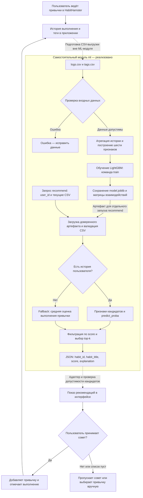

# Второй этап. Место ML-модели в процессе HabitHamster

Автор: Мандзулашвили Гогита Гогитович. Дата: 01.11.2026.
Модель: `HybridRecommender`, описанная в [model_card.md](model_card.md).

## Процесс и границы реализации

Ниже — диаграмма процесса в Markdown/Mermaid, показывающая место модели в процессе проекта.
Это схема места модели, а не исполняемый BPMN 2.0 файл.
Сплошные стрелки внутри ML-модуля показывают реализованные вызовы;
пунктир показывает предполагаемую интеграцию с приложением, которой в
самостоятельном CLI-модуле пока нет. Третий этап, посвящённый циклу переобучения, здесь не реализуется.

Для `recommend` нужен ранее сохранённый артефакт даже при cold start:
так устроена текущая CLI-команда. `demo` выполняет обучение и рекомендации
на синтетическом наборе. Ошибки обучения (недостаток данных или единственный
класс) останавливают запуск, новая модель не публикуется автоматически.

## Какую задачу решает модель

Модель поддерживает этап выбора следующей привычки: ранжирует кандидатов
по оценке класса исторического успешного выполнения. Она не решает за
пользователя и не управляет всем приложением. Бизнес-гипотеза: подходящие
рекомендации облегчат выбор и поддержат регулярность; эффект ещё не проверен.

## Почему здесь целесообразно ML

У пользователей различаются история, регулярность и интересы. LightGBM
может учитывать нелинейные сочетания этих признаков и сложности привычки,
вместо единого списка для всех. Целесообразность — гипотеза, которую нужно
подтвердить сравнением с простыми правилами и fallback на независимых данных.
При полном отсутствии истории пользователя предусмотрен подбор по среднему
выполнению. Короткая, но непустая история всё ещё направляется в классификатор;
отдельный анкетный механизм находится в `onboarding.py`.

## Какие данные поступают на вход

- История: пользователь, привычка, дата, статус выполнения, уровень и серия.
- Описание кандидата: название, тип и величина цели, теги.
- При запросе: `user_id`, число рекомендаций; в Python API также порог score.

Схемы CSV и точные расчёты признаков приведены в [Model Card](model_card.md).
Сейчас связь с приложением проходит через вручную подготовленные CSV;
модуль не подключается к базе Django и не содержит планировщика.

## Как используется результат дальше

Текущий результат — JSON в стандартном выводе CLI. Предполагаемый адаптер
приложения должен сопоставить кандидатов с разрешённым общим каталогом и
показать варианты пользователю. Передавать чужие личные названия напрямую
нельзя считать готовым безопасным решением. При пустом результате интерфейс
должен предложить ручной выбор; эта обработка пока относится к проектированию.

После принятия рекомендации пользователь выполняет привычку, а приложение
сохраняет новые логи. Для будущей оценки нужны также показы, отказы и принятые
рекомендации. Автоматическая обратная связь в обучение и оценка бизнес-эффекта
в данном ML-модуле пока отсутствуют.

## Второй этап: результаты работы

| Требование | Где выполнено |
| --- | --- |
| Model Card по Google: назначение, вход/выход, метрики, ограничения | [model_card.md](model_card.md), разделы 1–9 |
| Схема места модели в процессе | Mermaid-диаграмма выше |
| Задача модели и обоснование ML | Разделы «Какую задачу решает модель» и «Почему здесь целесообразно ML» |
| Вход и дальнейшее использование результата | Два соответствующих раздела выше |

Результаты второго этапа находятся в этих двух файлах в ветке `homework/ml-production`.
Третий этап описан отдельно в [процессе переобучения](Model_retrain_BPMN.md).
