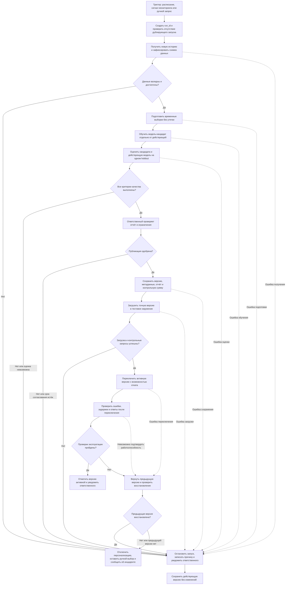

# Третий этап. Процесс автоматического переобучения HabitHamster

Автор: Мандзулашвили Гогита Гогитович.

## Назначение и границы

Процесс описывает обновление `HybridRecommender` от триггера до эксплуатации
новой версии. Цель — обновлять рекомендации по мере накопления истории,
сохраняя действующую версию, если кандидат не прошёл проверки.
Основа: [Model Card](model_card.md) и [место модели в проекте](Model_BPMN.md).

Это проектируемый процесс, изображённый в Markdown/Mermaid, а не исполняемый
BPMN-файл или уже работающий оркестратор. В `ml` реализованы CSV-валидация,
обучение LightGBM, сохранение/загрузка joblib и рекомендации через CLI.
Планировщик, мониторинг, независимая оценка, согласование и деплой ниже
описывают требуемое развитие проекта. Автоматические шаги сочетаются
с обязательным решением ответственного перед публикацией.

## Схема процесса

Стрелки показывают последовательность и передачу результатов; пунктир —
технические ошибки. Автоматического бесконечного возврата к обучению нет:
повторный запуск требует устранения причины или нового снимка данных.
Дубликат триггера для уже выполняющегося запуска завершается без второго обучения.

## Этапы, действия и передаваемые результаты

| Этап | Что происходит | Результат следующему этапу |
| --- | --- | --- |
| 1. Триггер | Проектируемое расписание — раз в неделю, понедельник 03:00 по Москве, при наличии новых данных. Дополнительные причины: подтверждённый сигнал дрифта, падение измеренного качества или ручной запрос ответственного | Причина запуска, время, текущая версия модели |
| 2. Регистрация запуска | Оркестратор создаёт `run_id`, фиксирует конфигурацию и блокирует конкурентную публикацию. Повтор одного события не создаёт второй запуск | Уникальный запуск, версия кода и конфигурации |
| 3. Получение данных | Из приложения выгружаются логи и теги; данные фиксируются как неизменяемый снимок. Доступ ограничивается, сырые данные не добавляются в публичный Git | Версия снимка, контрольные суммы, период и граница доступности данных |
| 4. Проверка данных | Проверяются схема, статусы, даты, пропуски, дубли, неотрицательные целые значения, принадлежность привычки одному пользователю, соответствие тегов привычкам. Проверяются свежесть, достаточность истории и наличие будущих меток для оценки | Отчёт проверки; при успехе — допущенный снимок |
| 5. Подготовка | История делится по времени на обучение, валидацию и финальную оценку. Признаки и CF-матрица строятся только из доступного прошлого; метки — из следующего окна. Преобразования фиксируются версией | Раздельные признаки и метки, границы окон, схема признаков |
| 6. Обучение | На обучающей части создаётся новый LightGBM-кандидат с воспроизводимыми параметрами и seed. Действующий артефакт не перезаписывается | Кандидат и журнал обучения |
| 7. Проверка качества | Кандидат и действующая версия оцениваются на одинаковых примерах и кандидатах. Проверяются качество, группы пользователей, корректность ответов и время предсказания | Отчёт сравнения и результат автоматического допуска |
| 8. Решение | Ответственный за модель проверяет отчёт, происхождение данных, ограничения и целесообразность обновления. Одобрение или отказ фиксируются с комментарием | Решение, автор и время; без одобрения публикации нет |
| 9. Сохранение версии | Одобренный кандидат получает уникальный `model_version`; сохраняются артефакт, матрица, метаданные и отчёт. Контрольная сумма проверяется после записи | Неизменяемый комплект версии со статусом approved |
| 10. Предварительная проверка | Именно сохранённая версия загружается в тестовом окружении; проверяются зависимости, схема артефакта, обычный запрос, cold start и пустой результат | Отчёт готовности к переключению |
| 11. Деплой | Адаптер приложения атомарно переключает ссылку на активный комплект. Путь предыдущей версии сохраняется; конкурентное обновление запрещено | Идентификатор активной версии, предыдущая версия, событие деплоя |
| 12. Контроль и завершение | Проверяются доступность, ошибки, задержки и формат ответов; запускается последующий мониторинг качества по мере появления меток | Статус active и уведомление либо откат и инцидент |

## Триггеры и достаточность данных

Расписание и пороги мониторинга — проектные настройки, не действующая
конфигурация. Сигнал дрифта сам по себе не разрешает публикацию: он лишь
инициирует проверку. Пороги дрифта и падения качества определяются по
реальному базовому периоду, фиксируются до запуска и утверждаются ответственным.
Если мониторинг ещё не настроен, доступны планируемое расписание и ручной запрос.

В текущем коде обучение требует минимум 50 логов, 30 пар пользователь–привычка
и два класса. Эти проверки сохраняются, но недостаточны для независимой оценки.
Для holdout дополнительно нужны два класса, достаточное число пользователей,
завершённое окно наблюдения и пригодные группы для анализа. Минимальные размеры
и длительности окон утверждаются заранее; если они не определены или данных
мало, результат — «недостаточно данных», публикация блокируется.

## Условия допуска новой версии

До первого автоматизированного запуска создаётся версионируемая политика допуска.
В ней задаются минимальные размеры выборок, метрики, пороги, допускаемая погрешность,
группы пользователей, пределы задержек и ошибок, срок согласования и период
наблюдения после деплоя. Это обязательный вход процесса, а не уже существующий файл.
Неустановленный порог означает блокировку, а не автоматическое согласие.

Кандидат может попасть в эксплуатацию, только если одновременно выполнены условия:

1. Данные и временное разделение прошли проверку; признаки не содержат будущих
   результатов. Версии кода, данных, окружения и признаков воспроизводимы.
2. ROC-AUC и F1 достигли заранее заданных минимальных значений. Для сравнения
   F1 используется один заранее выбранный порог; порог исторической метки 0.7
   и порог выдачи рекомендаций 0.5 не являются порогами допуска модели.
3. На одинаковом holdout кандидат не хуже действующей модели по основным
   метрикам в пределах утверждённого допуска и даёт заранее определённое
   улучшение по целевой метрике. Учитываются доверительные интервалы,
   рассчитанные с группировкой по пользователям. При неубедительном результате
   сохраняется действующая версия. Для первого релиза сравнение идёт с baseline.
4. Для пользовательского релиза рекомендаций дополнительно проверяются
   NDCG@5/Precision@5, охват и доля пустых ответов по общему допустимому каталогу
   с наблюдаемыми откликами. Если такого набора нет, подтверждать готовность
   рекомендаций одним ROC-AUC нельзя; разрешён только исследовательский кандидат.
5. Нет недопустимого ухудшения по заранее выбранным группам: например короткая
   история, тип цели, категория привычки. Cold start проверяется отдельно,
   поскольку в нём используется fallback, а не LightGBM.
6. Проверены формат и диапазон score, исключение своих привычек, отсутствие
   личных названий чужих привычек в публичном выводе, обработка пустого списка,
   совместимость и технические пределы. Получено ручное одобрение.
7. Сохранённая версия прошла загрузку и контрольные запросы. После переключения
   нет нарушения заданных технических пределов; иначе выполняется откат.

Численные пороги здесь намеренно не объявляются измеренными или согласованными:
реальный holdout и baseline пока отсутствуют. До их подготовки автоматический
допуск текущей модели в пользовательскую эксплуатацию закрыт.

## Версионирование и деплой

Предлагаемая структура закрытого хранилища: `models/<model_version>/` с
`model.joblib`, `metadata.json` и `evaluation.json`. Метаданные содержат
`run_id`, commit кода, версию данных и признаков, параметры, seed, зависимости,
границы временных выборок, контрольную сумму артефакта и решение ответственного.
Joblib включает модель и согласованную с ней матрицу; загружаются только
доверенные артефакты. Версия схемы joblib `1` в существующем коде не заменяет
уникальный номер обученного релиза.

Текущий `save()` атомарно записывает один файл, но не реализует реестр и деплой.
В проектируемом процессе запись производится по новому пути, затем адаптер
переключает указатель активной версии и загружает согласованный комплект.
Прежняя версия хранится для отката. Сохранение файла само по себе не означает,
что приложение уже использует новую модель.

## Неуспешные проверки и откат

- Ошибки данных, обучения, оценки, отказ или отсутствие одобрения: завершить
  запуск с причиной, оставить прежнюю активную модель, уведомить ответственного.
- Ошибка регистрации или тестовой загрузки: не переключать активный указатель;
  неполный комплект не получает статус approved/active.
- Ошибка переключения либо нарушение технических пределов после деплоя:
  вернуть указатель на предыдущий комплект и проверить контрольный запрос.
- Если откат не восстановил работу или предыдущего релиза нет: отключить
  персонализированные рекомендации, оставить ручной выбор из безопасного
  каталога и передать инцидент ответственному. Это тоже требует реализации
  в адаптере приложения; текущий CLI сам такой режим не обеспечивает.
- Отложенное ухудшение качества после появления новых меток создаёт инцидент
  и новый триггер. Решение об откате принимается по политике допуска;
  успешная техническая проверка сразу после деплоя не доказывает ML-качество.

Уведомление содержит `run_id`, версии, этап, причину и ссылку на закрытый отчёт,
без сырых пользовательских данных. Канал уведомления выбирается при реализации.
Ошибка уведомления фиксируется отдельно и не отменяет выполненный откат.

## Что необходимо до реализации автоматизации

Текущий `train()` строит цель и признаки из одной истории. Для описанного процесса
нужен отдельный построитель временных обучающих примеров и оценочный модуль;
просто запускать существующую команду чаще недостаточно. Нужны общий каталог
для осмысленного CF и безопасных кандидатов, логи показов/откликов, политика допуска,
оркестратор, хранилище версий и адаптер публикации/отката. Ограничения текущей
модели остаются зафиксированными в [Model Card](model_card.md).

Таким образом, третий этап задаёт проверяемую спецификацию процесса: триггер
запускает подготовку кандидата, а эксплуатация разрешается только после
независимой оценки, одобрения и технических проверок.
